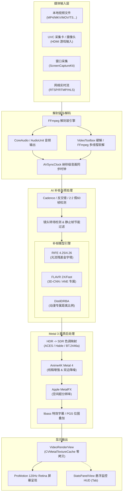

# Macrife Player

<p align="center">
  
</p>

<p align="center">
  <strong>专为 macOS / Apple Silicon 打造的下一代原生 GPU 实时 AI 补帧与画质增强播放器</strong>
</p>

<p align="center">
  
  
  
  
  
  
  
</p>

---

## 📖 项目简介

**Macrife Player** 是一款深度适配 **macOS Sequoia (15.0+)** 与 **Apple Silicon** 架构的高性能视频播放器。项目摒弃了跨平台框架的性能损耗，基于纯原生 **AppKit + Metal 3 + Apple Neural Engine (ANE)** 构建端到端硬件加速管线。

播放器集成了 **多架构实时 AI 视频插帧（RIFE / FLAVR / DistilDRBA）**、**MetalFX 空间超分辨率**、**Anime4K 动漫画质增强**、**电影级 HDR 转 SDR 色调映射** 以及 **UVC 主机采集卡低延迟电竞重构** 等前沿技术，致力于为 Apple Silicon Mac 用户带来丝滑、高画质且能效兼备的观影与主机游戏串流体验。

---

## ✨ 核心特性

### 🎬 1. 多架构实时 AI 补帧系统
- **三套算法内核自由切换**：
  - **RIFE 系列（光流残差金字塔）**：适配影视、纪录片与常规视频，提供 `4.25 Lite`、`4.25 HQ`、`4.26 HQ` 以及 `4.26 Heavy` 四种规格，支持 FP16 / FP32 精度切换。
  - **FLAVR 引擎（3D 时空卷积）**：无光流伪影，针对 Apple Neural Engine (ANE) 低功耗架构专属优化，内置 Hermite-Lagrange、Catmull-Rom 锐化与 B-Spline 三大卷积核。
  - **DistilDRBA 引擎（动漫二次元专属）**：基于距离比例算法，专攻 2D 动画。智能识别一拍二（12fps）与一拍三（8fps）抽帧节拍，具备线稿保护与夸张形变防撕裂。
- **丰富的补帧目标倍率**：支持 `2X`、`3X`、`4X`、`5X` 倍帧，以及强制 `60 FPS`、`120 FPS`（匹配 ProMotion 刷新率）和自定义目标帧率（30~240 FPS）。
- **智能场景转场保护（Scene Detection）**：实时计算前后帧运动直方图与特征相似度，遇到剪辑切镜转场时自动抑制插帧，彻底消除转场鬼影。
- **静止画面节能检测（Static Frame Skip）**：检测到画面静止或微小变动时自动跳过神经网络推理，显著降低 MacBook 续航与发热。

### 🎮 2. 主机采集卡与低延迟电竞模式
- **UVC 采集卡 / 雷电采集 / 摄像头全支持**：完美支持接入 Nintendo Switch、PS5、Xbox 或单反相机。
- **独创「假 60 帧智能识别与真 60 帧重构」**：
  - 针对游戏主机在 30 FPS 质量模式下通过采集卡输出 60Hz 信号（即 2:2 重复帧拉结），Macrife Player 能自动识别重复场，并将重复帧精准替换为 AI 运动插帧，**将主机 30 帧游戏实时重构成原生般丝滑的真 60 FPS**！
- **极限电竞超低延迟管线**：提供 1 帧极小缓冲零拷贝直出模式，毫秒级响应，游戏直连无明显输入滞后感。
- **专业级色彩范围校准**：支持全范围/限制范围（Full 0-255 / Limited 16-235）切换与 BT.601 / BT.709 / BT.2020 色彩矩阵纠偏，解决采集卡画面发灰或暗部死黑问题。

### 💎 3. 顶级画质后处理与超分辨率
- **Apple MetalFX 空间超分辨率（Spatial Upscaling）**：调用系统底层 MetalFX 框架，将 720p / 1080p 视频实时上采样至 2K / 4K / 视网膜清晰度。
- **Anime4K Metal 4 计算管线**：移植并重构完整的 Anime4K 动漫画质增强着色器，包含线稿重建强化与自适应双边降噪。
- **专业级 HDR 转 SDR 色调映射（HDR Tone Mapping）**：
  - 内置 ACES Filmic（电影胶片级）、Hable（Uncharted 2 经典曲线）、ITU-R BT.2446a（广电亮度保真）与 Reinhard 全局映射算法，HDR 视频在普通 SDR 屏幕上也能色彩鲜明、高光不爆。
- **智能倍频反交错（Deinterlacing）**：精准识别 1080 50i / 60i 隔行扫描视频（如 MTS / M2TS / TS 格式），通过双场反交错倍频至 50 / 60 逐行帧，告别横向拉丝。

### ⚡️ 4. 原生 Metal 零拷贝高能效渲染
- 基于 `CVMetalTextureCache` 建立从解码内存到 GPU 显存的零拷贝（Zero-Copy）直通桥梁，大幅降低内存带宽与 CPU 占用。
- 支持 NV12 双平面与 YUY2 / yuvs 打包 4:2:2 纹理硬件直传。
- 深度适配 Apple ProMotion 120Hz 自适应刷新率显示屏，音画纳秒级时钟对齐（`AVSyncClock`）。

### 🔊 5. 多音轨、多格式字幕与网络流
- **全格式媒体解封装**：基于定制 FFmpeg 7 体系，完美支持 MP4、MKV、MOV、WebM、FLV、AVI、TS、M2TS、MTS 等主流封装。
- **libass 高精矢量字幕渲染**：原生支持 SSA/ASS 特效字幕与内嵌字体自动提取加载，以及 PGS / DVB 等蓝光位图字幕，支持外挂字幕动态拖拽导入与同名自动匹配。
- **低延迟网络流播放**：支持 RTSP、RTMP、HLS、HTTP 网络流直接拉流播放与实时插帧。
- **屏幕与窗口采集**：集成 ScreenCaptureKit，可直接捕获其他应用窗口画面（如模拟器、视频流）并实时提升画质与帧率。

### 📊 6. 极客性能监看 HUD（按 Tab 键唤出）
- 专为性能调优与画质对比打造的无背景悬浮监视 HUD，毫秒级刷新：
  - **源视频参数**：封装格式、编解码器、分辨率、原始帧率、像素格式、色域矩阵、音轨信息。
  - **补帧/后处理状态**：目标帧率、计算精度、活跃核心数、MetalFX / Anime4K / HDR 状态。
  - **实时性能参数**：实际渲染 FPS、解码 FPS、丢帧数/跳帧数、队列缓冲深度、音画时钟偏差（AV Drift）、GPU / CPU 负载。

---

## 🏗️ 架构与数据流



---

## 🧠 AI 补帧模型对比

| 模型架构 | 核心原理 | 优势特点 | 适用场景 | 功耗与推荐设备 |
| :--- | :--- | :--- | :--- | :--- |
| **RIFE 4.25 / 4.26** | 双向光流残差金字塔 (Coarse-to-fine) | 真实运动估计，大动态场景平滑连贯 | 真人电影、电视剧、体育赛事、动作大片 | GPU 吞吐型，推荐 M1/M2/M3 Pro/Max/Ultra |
| **FLAVR** | 3D 时空卷积 (Spatiotemporal Conv) | 纯卷积直出、无光流扭曲伪影，时序过渡极佳 | 追求极致静音低功耗观影、中等运动幅度视频 | ANE (神经网络引擎) 优化，适合 MacBook Air / 电池模式 |
| **DistilDRBA** | 距离比例调整 (Distance-Ratio Based) | 保持手绘线条轮廓锐利、专攻 8fps/12fps 抽帧动作 | 日本番剧、2D 手绘动画、二次元动画短片 | 极佳的动漫线条防撕裂，全系列 Apple Silicon 均推荐 |

---

## ⌨️ 快捷键与常用手势

| 快捷键 | 功能操作 |
| :--- | :--- |
| **Space** | 播放 / 暂停 |
| **← / →** | 快速快退 / 快进 5 秒 |
| **Tab** | 开启 / 关闭 **极客性能监看 HUD** |
| **⌘ + Shift + R** | 打开 **AI 补帧详细配置与模型专属定制面板** |
| **⌘ + O** | 打开本地视频文件 |
| **⌘ + L** | 展开 / 收起播放列表面板 |
| **⌘ + R** | 重新载入当前视频（保持进度与音轨配置） |
| **⌘ + W** | 关闭当前播放的视频 |
| **Esc** / **双击画面** | 进入 / 退出全屏模式 |
| **文件直接拖拽** | 将视频文件、播放列表或字幕文件直接拖入窗口即刻播放或加载 |

---

## 💻 运行环境要求

- **操作系统**：macOS 15.0 (Sequoia) 或更高版本
- **硬件架构**：仅支持 **Apple Silicon (arm64)** 芯片（M1 / M2 / M3 / M4 家族系列）
- **开发与构建工具**：Xcode 16.0+
- **系统权限说明**：
  - **屏幕录制权限**：使用“窗口采集 (ScreenCaptureKit)”功能时需要授权；
  - **摄像头与麦克风权限**：使用“采集卡 / 摄像头实时输入”功能时需要授权。

> 💡 **依赖说明**：本项目所需的 FFmpeg 核心动态库（`libavcodec`, `libavformat`, `libswscale`, `libass` 等）已在 `Frameworks/` 目录中完成预构建与封装，**无需手动通过 Homebrew 安装额外复杂的依赖**。

---

## 🚀 编译与运行指南

### 1. 克隆代码仓库
```bash
git clone https://github.com/TeeAte/MacrifePlayer.git
cd MacrifePlayer
```

### 2. 使用 Xcode 打开工程
```bash
open MacrifePlayer.xcodeproj
```

### 3. 配置签名与运行
1. 在 Xcode 左侧项目导航中选择 `MacrifePlayer` 工程；
2. 进入 **Signing & Capabilities**，选择你的个人开发者账号或勾选本地自签名（Development）；
3. 目标 Scheme 选择 **MacrifePlayer**，构建设备选择 **My Mac**；
4. 点击 **Run (⌘ + R)** 即可编译并启动播放器。

---

## 🛠️ 进阶调试与命令行参数

Macrife Player 支持通过命令行启动并注入调试参数，便于性能评测与无头自动化测试：

```bash
# 启动播放器并在控制台导出实时性能统计数据
open -n "Release/Macrife Player.app" --args --dump-stats

# 指定延迟时间后抓取统计快照
open -n "Release/Macrife Player.app" --args --dump-stats --dump-delay=5
```

也可以通过系统环境变量进行调试控制：
- `MP_TRACE=1`：开启全管线纳秒级诊断日志；
- `MP_DUMP_STATS=1`：定时向 stdout 输出引擎状态指标。

---

## 📁 目录结构导览

```text
MacrifePlayer/
├── MacrifePlayer/              # 核心功能模块与业务实现
│   ├── App/                    # 手写入口 main.swift 与生命周期
│   ├── Anime4K/                # Anime4K Metal 4 动漫画质增强与参数预设
│   ├── Audio/                  # 音频调度、静音帧读取器与休眠电源保护
│   ├── Capture/                # UVC 采集卡、摄像头与 ScreenCaptureKit 窗口采集
│   ├── FFmpeg/                 # FFmpeg 音视频与字幕解封装封装适配层
│   ├── Media/                  # 媒体会话、网络流管理与轨道管理器
│   ├── Metal/                  # Metal 零拷贝纹理视图与 MetalFX 空间超分辨率
│   ├── RIFE/                   # RIFE / FLAVR / DRBA 补帧引擎、张量工作区与转场检测
│   ├── Subtitle/               # libass 与 PGS 位图字幕解析及渲染
│   ├── Support/                # 色彩空间管线、反交错器、主线程卡顿监视与日志工具
│   └── UI/                     # 控制器状态、播放列表与命令中心
├── Playback/                   # 播放引擎驱动层与高级交互
│   ├── App/                    # AppDelegate 菜单动作编排与全局事件总线
│   ├── Subtitle/               # ASS/SSA 特效字幕渲染与内嵌字体支持
│   ├── UI/                     # 控制条 (ControlOverlayView)、HUD (StatsPanelView)、RIFE高级配置面板
│   ├── AVSyncClock.swift       # 纳秒级音画同步主时钟
│   ├── CadenceDetector.swift   # 24p 电影与抽帧节奏探测器
│   ├── Deinterlacer.swift      # 隔行视频双场倍频反交错器
│   ├── HDRToneMapper.swift     # ACES / Hable / BT.2446a HDR 色调映射
│   ├── PlaybackEngine.swift    # 播放调度核心驱动
│   ├── RIFEInterpolationEngine.swift # GPU 运动估计与形变插帧管线
│   └── VideoRenderView.swift   # Metal 视网膜渲染器 (CVMetalTextureCache)
├── FFmpegShim/                 # FFmpeg C 接口 Bridge 与 Modulemap
├── Frameworks/                 # 预编译针对 Apple Silicon arm64 的动态库
├── Resources/                  # 本地化多语言、Metal Shader Lib、Anime4K 权重、模型文件
└── MacrifePlayer.xcodeproj     # Xcode 统一项目工程配置
```

---

## 👨‍💻 开发者与致谢

- **作者 / 开发者**：[TeeAte](https://github.com/TeeAte)
- **联系邮箱**：[Theate1423@gmail.com](mailto:Theate1423@gmail.com)
- **交流 QQ**：2690233941

如果你觉得 Macrife Player 为你的观影体验或主机游戏串流带来了实质提升，欢迎在 GitHub 页面为本项目点上一颗 ⭐️ **Star**，也欢迎在应用内关于面板通过微信或支付宝支持后续的算法迭代与设备测试！

---

## 📄 免责与许可声明

- 本项目内部集成的预编译动态库遵循各自开源许可证（包括但不限于 FFmpeg - LGPL/GPL, libass - ISC, Anime4K - MIT）。
- 本播放器仅供技术学习、音视频开发研究与个人娱乐使用，请勿用于侵犯任何版权内容的商业分发。
